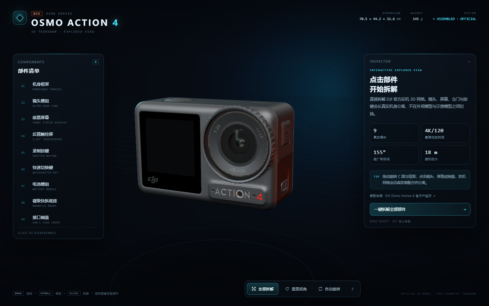

# DJI Osmo Action 4 · 3D 实机拆解

基于 DJI 官方 Osmo Action 4 3D 模型制作的交互式拆解页面。镜头、前后屏、电池仓门、接口侧盖、顶部按键与磁吸底座均为实机网格，可直接点击拆装。



## 在线预览

https://dlutwizard.github.io/dji-action4-3d-teardown/

## 本地预览

在本目录启动任意静态文件服务器，例如：

```bash
python -m http.server 8765
```

然后打开 `http://127.0.0.1:8765/`。

## 功能

- 官方 GLB 实机外观，非程序化近似模型
- 9 个真实外观模块，一键拆解 / 组装
- 点击或悬停部件查看参数
- 桌面与移动端适配
- Three.js 与模型资源均随仓库提供，不依赖 CDN

## 声明

DJI、Osmo Action 4 及相关产品素材归大疆创新所有。本项目仅用于交互式产品展示与技术演示。
